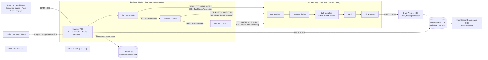

# Architecture

## Components (what each one does and why)

| Component | Where | Role |
|---|---|---|
| React frontend | `src/` | Original educational simulator (unchanged) + new **Real Telemetry** page (`src/pages/Real.tsx`, `src/realApi.ts`). |
| Gateway API | `backend/src/app.js` | `GET /health`, `POST /simulate`, faults, trace status, pipeline metrics, S3 archive. Validates input, CORS, graceful shutdown. |
| Services A, B, C | `backend/src/services.js` | Three real HTTP servers on loopback. A starts the trace, calls B, B calls C. Latency and failures are injected per request (seeded, reproducible). |
| OTel SDK | `backend/src/telemetry.js` | One tracer provider per service so each span has the right `service.name`; OTLP/HTTP export with `BatchSpanProcessor`; W3C trace-context propagation; errors recorded with `recordException` + status ERROR. |
| Collector | `collector/otel-collector-config.yaml` | `memory_limiter` -> `tail_sampling` -> `batch` -> OTLP exporter. |
| Tail sampling | same file | Keeps a trace if ANY policy matches: has an ERROR span, OR duration >= 500 ms, OR 10% probabilistic. Waits `decision_wait` (10 s) so all spans of a trace are seen before deciding. |
| Batch processor | same file | Groups spans into export requests (`BATCH_SIZE`, `BATCH_TIMEOUT`). |
| Data Prepper | `data-prepper/pipelines.yaml` | Receives OTLP, converts spans to OpenSearch trace-analytics documents, builds the service map. |
| OpenSearch | `docker-compose.yml` | Stores searchable spans (search by `traceId`, `serviceName`, `status.code`). |
| Dashboards | `docker-compose.yml` | UI: Observability -> Trace analytics. |
| S3 archive | `backend/src/archive.js` | Reads spans from OpenSearch, writes gzip NDJSON to S3, verifies with HeadObject (size + SHA-256 metadata). |
| CloudWatch | `docs/AWS_SETUP.md` | Optional infrastructure/S3 monitoring and cost alarm. Not wired into code. |

## Why tail sampling needs ONE decision point
A trace's spans come from three services and arrive at different moments. The sampler must see all of them before choosing, so all spans of a trace must reach the **same** Collector instance. This lab uses one Collector, which guarantees it. With several Collectors you would put a load-balancing exporter (routing by trace ID) in front. Verified: no partial traces were stored in the test run (see `docs/STATUS.md`).

## Ports (all bound to 127.0.0.1)
| Port | Service |
|---|---|
| 4000 | Backend API |
| 4317 / 4318 | Collector OTLP gRPC / HTTP |
| 8888 | Collector internal metrics |
| 13133 | Collector health |
| 9200 | OpenSearch |
| 5601 | OpenSearch Dashboards |
